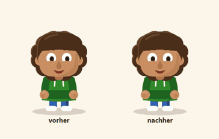
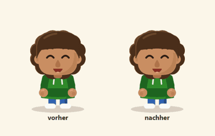

# Lernquest – Bewegung der Figuren

Stand 27.11.2026. Ergänzt [`../prinzipien.md`](../prinzipien.md): dort Form und Fläche, hier Bewegung. Wie dort gilt:
von Duolingo lernen wir die **Regeln**, nicht den Look (keine Eule, keine Duolingo-Figuren, keine Farbwerte).

| vorher → nachher | |
|---|---|
|  |  |

## Was Duolingo selbst sagt
- Die Figur macht „leichte, ausdrucksstarke Bewegungen“ und **keine plötzlichen oder schnellen**.
  [design.duolingo.com/writing/duo](https://design.duolingo.com/writing/duo)
- „Timing ist alles“: erst mehrere grobe Fassungen, dann Rhythmus und Energie verfeinern.
  [blog.duolingo.com/streak-milestone-design-animation](https://blog.duolingo.com/streak-milestone-design-animation/)
- Ruhe ist nicht Stillstand: Nicken, Blinzeln, Brauen. Am Ende reagiert die Figur auf richtig oder falsch; jede
  Figur hat ihre eigene Richtig-Bewegung, Feiern kommt nach einigen Richtigen in Folge.
  [blog.duolingo.com/world-character-visemes](https://blog.duolingo.com/world-character-visemes),
  [blog.duolingo.com/building-character](https://blog.duolingo.com/building-character/)
- Keine eintönige Ruhe-Schleife: mehrere kurze Ruhe-Bewegungen für Kopf und Körper, zufällig kombiniert. Beim Warten
  „denkt“ die Figur sichtbar. [rive.app/blog/…lily-to-life](https://rive.app/blog/duolingo-s-ai-powered-video-call-brings-lily-to-life)
- Wenige Bewegungen, die ineinander **übergehen und sich mischen**, statt vieler fertiger Clips; Kopf und Körper
  bewegen sich getrennt. [rive.app/blog/…lily-to-life](https://rive.app/blog/duolingo-s-ai-powered-video-call-brings-lily-to-life),
  [blog.duolingo.com/world-character-visemes](https://blog.duolingo.com/world-character-visemes)
- Einfache Formen machen Zeichnen und Bewegen billiger; lose, „schwebende“ Teile lassen sich leichter drehen und posieren.
  [design.duolingo.com/illustration/shape-language](https://design.duolingo.com/illustration/shape-language)

Kurven, Ausholen, Strecken und Stauchen, Nachziehen: dazu veröffentlicht Duolingo nichts. Die Regeln unten sind die
klassischen Grundsätze der Animation, passend zu „keine plötzlichen Bewegungen“.

## Was der Motor kann (`src/lernquest/figuren/bewegung.ts`)
- **`weich`** (Standard) ist eine Kurve durch alle Schlüsselbilder: Sie bremst nur, wo ein Wert umkehrt (oben im
  Sprung, am Ende eines Winkens) und am Anfang und Ende einer Bewegung, schießt nie über ein Schlüsselbild hinaus und
  läuft durch Zwischenpunkte ohne anzuhalten. Vorher hielt jede Spur an jedem Schlüsselbild kurz an.
- **`kurven`** je Abschnitt: `rein` (immer schneller, zum Fallen), `raus`, `linear`, `feder`.
- **`versatz`** je Spur (Anteil eines Durchlaufs): die Spur zieht nach. Eine Bewegung mit Ende endet trotzdem in Ruhe.
- **`vorne`** je Bewegung: Teile, die während der Bewegung vor dem Kopf liegen (ein erhobener Arm), zusätzlich zur Pose.
  Nur Teile der obersten Ebene (Arm, nicht Unterarm); ein Test prüft das für jede Figur.
- **Übergang** (`UEBERGANG`, 0,2 s): Neue Pose oder neue Bewegung gleitet vom zuletzt gezeigten Bild aus; das Gesicht
  wechselt sofort, weil es die Reaktion zeigt. Aus in der Werkstatt (eigene Zeit) und bei „Bewegung reduzieren“.

## Welche Bewegung wofür
- **`hallo`**: Begrüßen, für Figuren mit hängenden Armen (Held). Arm hoch, dreimal winken, Arm runter.
- **`winken`**: wackelt nur einen Arm, den die Pose schon erhoben hat (Pose `winken`, z. B. der Fuchs). Ohne diese Pose
  winkt nur die Hand neben der Hüfte.

## Faustregeln für neue Bewegungen
- **Ausholen**: vor einer großen Bewegung kurz in die Gegenrichtung (etwa 15 % der Dauer), z. B. in die Knie vor dem Sprung.
- **Strecken und Stauchen**: gestreckt, solange es schnell geht (Absprung, Fallen), oben fast normal, gestaucht beim
  Aufprall. Das Volumen bleibt: x und y gegenläufig (1,14 / 0,86).
- **Schwerkraft**: vom höchsten Punkt nach unten `rein`, das letzte Stück bis zum Boden `linear`; die Geschwindigkeit
  am Übergang soll passen (siehe `huepfen`).
- **Nachziehen** (`versatz`): Unterarm und Hände 0,04–0,06, Kopf 0,03–0,08, Schwanz, Haare, Lose 0,08–0,15.
- **Hände nie übers Gesicht**: Der Held hat kurze Arme und einen großen Kopf. Winkel für Arme am Kopf erst im Raster
  ausprobieren (Werkstatt „Pose“); beim Helden winkt die Hand bei Oberarm etwa −110° und Unterarm +15…+45° neben dem Kopf.
- Keine Spur springt von Bild zu Bild: `bewegung.test.ts` prüft jede Bewegung bei 60 Bildern je Sekunde.

## Als Nächstes
- Ruhe-Varianten: kurze Kopf- und Körperbewegungen, zufällig kombiniert, statt nur `atmen`.
- Beine für den Helden (Absprung aus den Knien) und Nachschwingen für Haare, Hut und Begleiter.
- Messen, ob viele Figuren gleichzeitig ruckeln (jede zeichnet je Bild in React neu); wenn ja, Transformationen direkt setzen.
